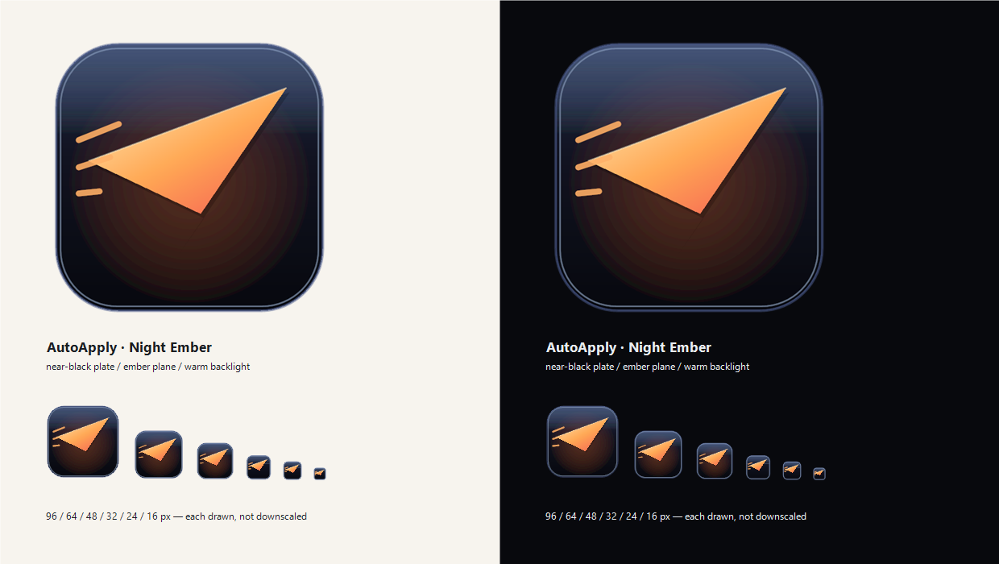
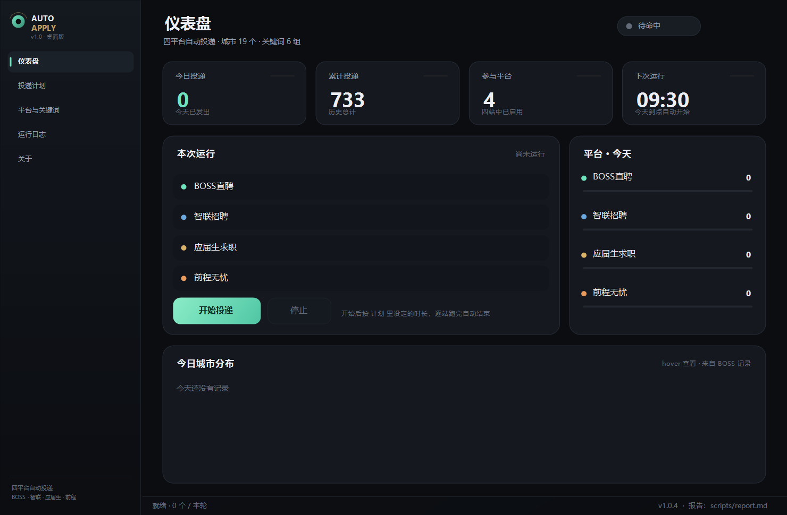
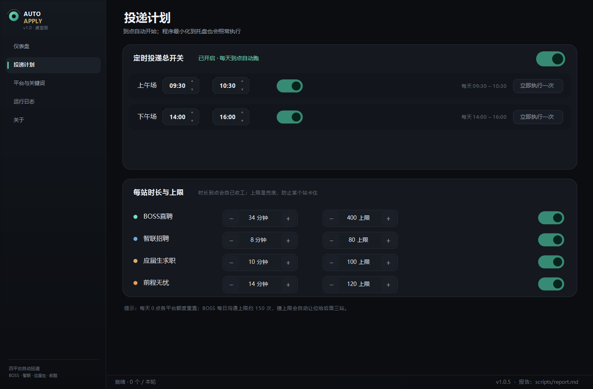
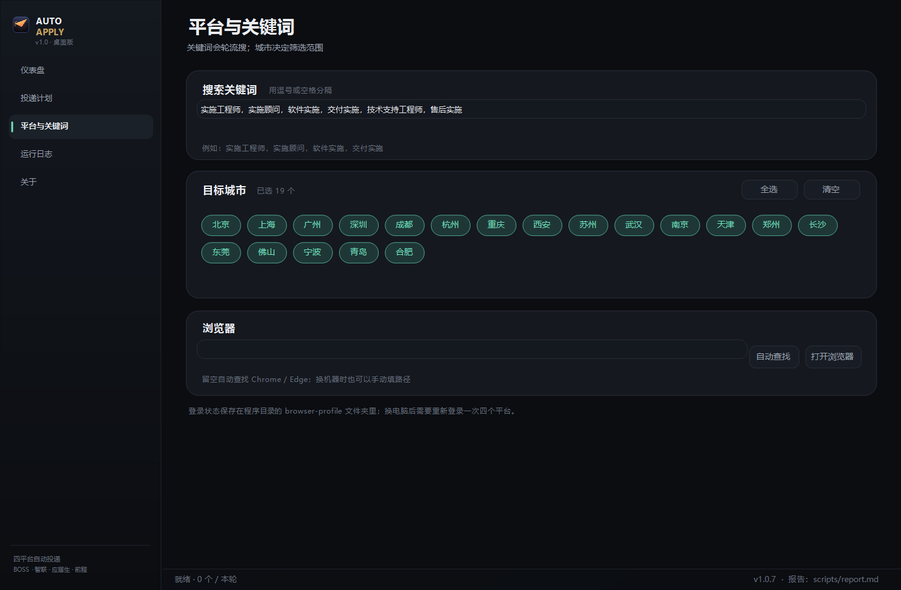
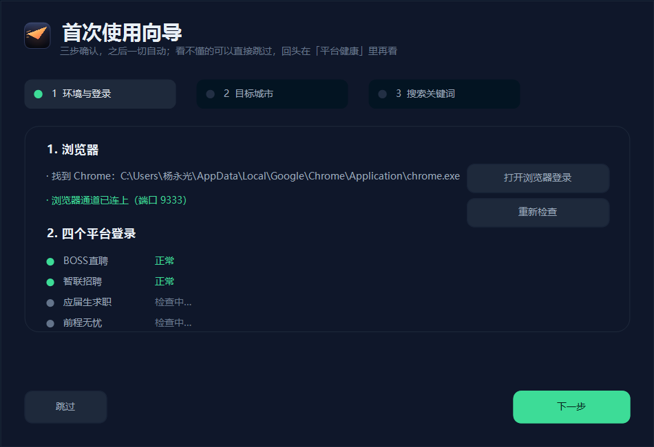
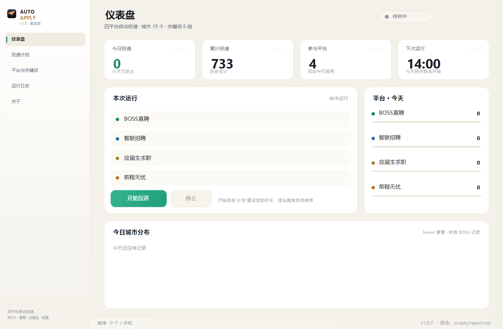
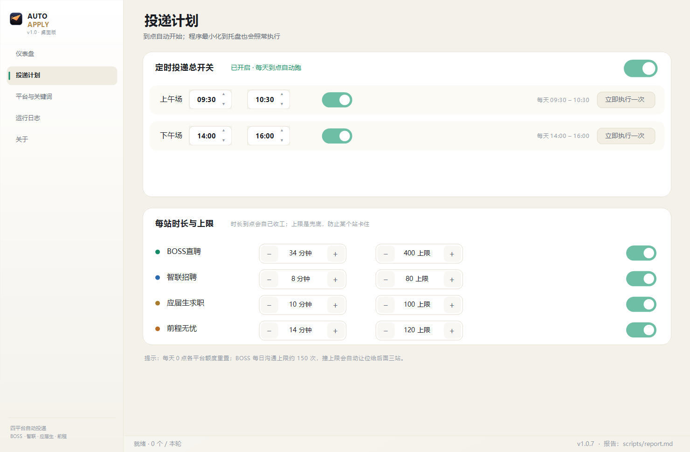

# AutoApply · 四平台自动定时投递




> 一个 614 KB 的绿色小工具：到点自动打开浏览器，替你在 **BOSS直聘 / 智联招聘 / 应届生 / 前程无忧** 四个平台上批量投递岗位，投完自动收工。
>
> 解压即用 · 无需安装 · 不联网到任何第三方服务器（只和四个招聘网站通信）



---

## 下载

最新版 **v1.8.6**：[AutoApply-1.8.6-win-x64.zip](https://github.com/YYG3453/AutoApply/releases/latest)（26.8 MB）

解压到任意目录、双击 `AutoApply.exe` 即用。升级时覆盖 exe 和 `scripts\*.js` 即可，投递记录在 `data\`，不会被覆盖。全部版本见 [Releases](https://github.com/YYG3453/AutoApply/releases)。

## 特性

| 能力 | 说明 |
| --- | --- |
| 四个平台一站安排 | BOSS直聘、智联招聘（zhaopin.com）、应届生（yingjiesheng.com）、前程无忧（51job.com），按顺序串行执行 |
| 定时窗口 | 默认每天 **09:30–10:30** 与 **14:00–16:00** 两段，时间可在「投递计划」里改，也可以关掉只手动跑 |
| 城市覆盖 | 一线 + 新一线共 19 城：北京 上海 广州 深圳 成都 杭州 重庆 西安 苏州 武汉 南京 天津 郑州 长沙 东莞 佛山 宁波 青岛 合肥 |
| 关键词轮换 | 6 组关键词（实施工程师、实施顾问、软件实施、交付实施、技术支持工程师、售后实施）自动轮流搜，跑满时段再从头来 |
| 智能让位 | 某个平台当日触顶 / 撞上安全验证时，该站立即停止，把时间让给后面三站，不会空转 |
| 真实回执 | 每个平台都按**接口返回**判定成功，不再把「被挡回的点击」当成投递成功 |
| 日夜双主题 | 墨色夜晚 / 宣纸日间两套调色板，右上角一键切换，选择记在 `config.json` 里，下次启动沿用 |
| 自绘界面 | GDI+ 全自绘、双缓冲、无闪烁；顶部条与四周边缘按住即可拖动窗口，最小化到托盘后定时照跑 |
| 记录与报告 | 每次投递写数据目录里的 `state-*.jsonl`，一键打开 `report.md` 看按平台/城市/日期的汇总（数据目录见「关于」页：便携版在 `data\`，否则 `%LOCALAPPDATA%\AutoApply`） |
| 零依赖 | 自带 `node\node.exe`，界面用系统自带的 .NET Framework 4.x 编译；**不需要装 Python、Node、Electron、运行库** |





---

## 快速开始

1. **解压** 到任意目录（路径里尽量别有中文空格以外的怪字符）。
2. 双击 **`AutoApply.exe`**。
3. 进「平台与关键词」→ 点 **「打开浏览器」**。会弹出一个小 Chrome 窗口（独立的浏览器目录，不影响你自己平时用的 Chrome）：
   - 依次在四个标签页里用**手机扫码登录**（BOSS直聘 / 智联招聘 / 应届生 / 前程无忧各一次）；
   - 登录状态会保存在程序目录的 `browser-profile\` 文件夹里，**下次不用再登**。
4. 回到程序：点 **「开始投递」** 立刻跑一轮，或者什么都不做，等定时窗口自己开始。

> 想先看看会投哪些岗位而不真的投？在程序目录执行
> `AutoApply.exe` 里没有 dry-run 按钮，可以用命令行：
> `node\node.exe --experimental-websocket scripts\boss.js --minutes 2 --dry`

---

## 它到底怎么工作

1. 程序用 `--remote-debugging-port` 起一个受控的 Chrome，页面都在这个窗口里操作。
2. 四个平台的脚本（`scripts\*.js`）通过 Chrome DevTools Protocol 在页面里点搜索、点卡片、点投递，全部走真实 DOM 与真实接口。
3. 每投一个就写一行记录到 `scripts\state-*.jsonl`（岗位、公司、城市、薪资、时间），去重后再投。
4. 收工后跑 `make-report.js` 汇总成 `scripts\report.md`。

时间与上限都是「软」的：每站配了 **时长** 和 **上限** 两个闸，哪个先到就停哪站。

---

## 1.0.10 新增：卫生与自检

| 能力 | 说明 |
|---|---|
| 收编旧定时任务 | 启动时检查 `BOSSTouDi-Morning` / `BOSSTouDi-Afternoon` / `BOSSChat-Reply`，仍在运行就自动禁用，避免和应用内定时器双跑（读不到任务计划程序时会弹提示，让你手动禁用或用管理员身份跑一次） |
| 历史数据合并 | 首次启动把旧版 `_automation\boss-apply\state-*.jsonl` 的投递记录按行去重导入到 `scripts\`，仪表盘累计数不再归零 |
| 登录态自检 | 每站开跑前用无头方式检查页面：未登录 / 滑块验证 / 页面无响应 → 该站直接跳过，并在托盘弹通知告诉你需要做什么，不再静默"好像没岗位" |
| 运行中锁配置 | 投递进行中，计划页与城市/关键词不可改，防止跑到一半改了参数 |
| 单实例 | 重复双击只会把已经在跑的窗口叫到前面，不会开第二个（两个实例抢同一个 CDP 端口必然出事） |

## 1.2.0：地基 + 投递明细

这一版几乎全是"地基"，界面上只多了一个「投递明细」页面。

### 1）配置契约：不再写坏、不再写脏

- `config.json` 多了 `SchemaVersion`（当前 2），以后改字段含义就 +1 并在 `Load` 里写迁移分支。
- **原子写**：先写 `config.json.tmp` → `fs.Flush(true)` 落盘 → `File.Replace` 整体替换，旧文件留成 `config.json.bak`。写到一半断电也不会留下半截配置；主文件坏了会自动读 `.bak`。
- **计算属性不再落盘**：`StartMins / EndMins / Range / RanToday_` 加了 `[ScriptIgnore]`，以前它们会被序列化进 config 里，纯属噪音。

### 2）RecordStore：四个 state 文件的读取层

- 新增 `src\Data\RecordStore.cs`：一行式容错解析（坏行计入 `BadLines` 不崩）、按天/站/城市建内存索引、按时间倒序。
- 原 `Config.cs` 里的 `Stats` 删掉，统计逻辑不再和配置混在一起。
- **顺手修了"图表在说谎"**：以前城市分布只统计 BOSS 一家的数据，现在四站合并（今天：北京 91 / 杭州 60 / 上海 53 / 其他 187）。

### 3）导航注册表化

- 新增 `src\Nav.cs`：一个页面 = 一行（key / 标题 / 分组 / 工厂方法）。导航栏、路由、`--page` 参数、`--render` 全部读这张表。
- 菜单按 概览 / 投递 / 系统 分组，加页面只改一处。

### 4）投递明细（唯一看得见的新东西）

- 1124 条记录一张表：时间 / 平台 / 城市 / 公司 / 岗位 / 薪资。
- 筛选：今天 / 近 7 天 / 近 30 天 / 全部；全部站 / BOSS / 智联 / 应届生 / 前程。
- 表头点击排序（时间/平台/城市/公司/岗位，升降序切换），滚轮翻页，行悬停高亮。
- 「导出 CSV」写到 `scripts\records-<时间>.csv`（UTF-8 带 BOM，Excel 直接打开不乱码）。
- 已知限制：前程无忧、应届生的记录里没有公司名字段，公司列显示 “—”。


## 1.3.0：匹配规则 + 被过滤

以前"投不投"没有判断，搜到什么投什么。这一版加了打分闸门，而且规则全部可改。

### 1）打分怎么算

脚本 scripts\score.js，每次投递前算一次（满分 100）：

| 项 | 分值 |
|---|---|
| 基础分 | 40 |
| 标题命中"必须包含"里的词 | +25 |
| 标题含技能词 | 每个 +4（最多 +16） |
| 标题和当前搜索关键词一致 | +8 |
| 标题命中"排除词" | 直接 0 分（跳过） |
| 公司命中黑名单（派遣/外包…） | 直接 0 分（跳过） |

低于分数线（默认 55）就不投。标题里一个"必须包含"的词都没有时，默认也跳过——但这一条可以在界面上关掉。

### 2）规则在哪改

左侧「匹配规则」页：分数线 ±5 调、标题必含开关、四组词表（标题必含 / 标题排除 / 公司黑名单 / 技能词）。每个词都是可点掉的圆角标签，新增就是"填新词 → 点那组的 ＋"。

改完点「保存并生效」写入 scripts\rules.json，下一轮投递就按新规则走。右上角还有「试算」：输入一个岗位标题，立刻看到几分、卡在哪。

### 3）被过滤页

左侧「被过滤」：规则拦下来的岗位列表（时间 / 平台 / 分数 / 标题 / 公司 / 原因），顶部是"今天 N 条 · 累计 N 条"和主因统计（比如"标题含排除词 12 / 公司黑名单 5"）。答案就在这一页：为什么没投这家。

数据写在 scripts\state-skip.jsonl，和投递记录一样是追加式，不会重复记同一岗位。

### 4）四站的差异（如实说明）

- BOSS、智联：标题和公司都能拿到，四条规则全生效
- 应届生、前程无忧：记录里没有公司字段，公司黑名单对这两站不生效（只按标题判）


## 1.4.0：运行分析

这一版回答三个问题：**投得准不准 / 为什么没投出去 / 每站到底花了多久**。

### 1）运行记录 runs.jsonl

以前每轮的时间、每站投了几条、为什么停，只存在于控制台日志文本里，正则解析不可靠。现在引擎每跑完一站就追加一行到 `scripts\runs.jsonl`：

`{"run":"2026-11-18T12:12:13","ts":"...","window":"手动运行","site":"yjs","name":"应届生求职","mins":1.9,"sent":3,"stop":"time"}`

- `run` = 这一轮的起始时间（同值归为一批）
- `stop` = 结束原因：`time` 时间到 / `limit` 平台限额 / `captcha` 验证码 / `login` 未登录 / `nosent` 发不出去 / `exhausted` 没有更多岗位

### 2）运行分析页（左侧「投递」组）

- **评分分布**：0–100 分 10 档柱状图，绿=投出、灰=被拦，橙色虚线是当前阈值（跟随你的规则文件）；早期没有分数字段的记录单独标"无分数"，不混进柱子
- **失败原因 Top**：两栏合并排 —— 上面三条是平台层失败（撞限额/验证码/未登录/页面挂死），下面三条是被规则拦下（标题不含指定词/标题含排除词/公司黑名单/分数不足）
- **每站耗时**：最近一轮里每个站花了多少分钟、投了几条、为什么停；撞限额的那站用橙色标出来

### 3）历史回填

第一次打开可能只有新数据，仓库里带了 `tools\backfill-runs.js`，可以从旧版的 `task.log` 把历史补进 runs.jsonl：

`node tools\backfill-runs.js "D:\...\_automation\boss-apply\task.log"`

它会按"相邻两行间隔 > 20 分钟 = 新的一轮"自动分批，并去重。

### 已知限制

- 11-17 及更早的投递记录没有 `score` 字段，评分分布里会显示"无分数"，不影响新数据
- 调度任务（09:25 / 13:55）拉起的是同一个实例，runs.jsonl 只记真实的投递轮次


## 1.5.0：回复与约面（漏斗）

投了多少只是前半句，这一版补上后半句：**有没有人回、有没有约到面试**。

### 数据从哪来

新增 scripts\replies.js，**只读**打开两个平台的会话列表，把"最后一条是谁说的、说了什么"记下来写进 scripts\state-replies.jsonl。它一个字都不会发出去——自动回复按你的要求一直是关的。

- 每轮投递结束后自动跑一次（Engine 收尾调用，失败不影响投递结果），也可以手动：
ode --experimental-websocket replies.js --max 30
- 覆盖：BOSS 直聘（/web/geek/chat）与智联招聘（i.zhaopin.com/im）；前程无忧、应届生的聊天在 App 里，网页端没有入口

### 会话状态怎么判

按最后一条对方消息的内容打标签，优先级从高到低：

| 状态 | 判定依据 |
|---|---|
| 约面试 | 面试 / 复试 / 约个时间 / 什么时候方便 / 简历通过 |
| 要简历 | 附件简历 / 发一份简历 |
| 不合适 | 不合适 / 不匹配 / 已招满 / 暂时不需要 / 方向不合适 / 祝好 |
| 岗位不符 | 兼职 / 外包 / 派遣 |
| 已回复 | 其它有内容的回复 |
| 未回复 | 最后一条是我方或系统消息 |

### 界面上多出来的东西

「运行分析」顶部从三张卡变四张：今日被拦 / 平台失败 / **有回复** / **约面试**；每站耗时卡下面多一块"最近有动静的会话"，约面的排最前面。

### 已知限制

- BOSS 的会话头部只有 HR 名字和岗位，**没有公司名**（也没有职位详情链接），所以这些记录的"公司"是空的；也正是这个原因，投递明细页暂时**没有**加"回复"列——只能按岗位名+城市模糊匹配，容易张冠李戴，宁可不加。
- 平台自动发的招呼语会被识别成我方消息（靠固定前缀"您好，我有洗浴管理软件"判断），如果你改了招呼语要同步改这个前缀。


## 1.6.0：平台健康 + 回复判定修正

### 平台健康（新页：「系统 → 平台健康」）

一屏看完四站状态，不用再翻日志猜：

- 顶部四张卡：CDP 端口是否连上、Chrome 版本、当前标签页数、待处理站点数；
- 每站一张卡：标签页数量 / 登录态 / 是否有验证码 / 最近一轮投递结果（条数 + 停止原因）；
- 每站两个按钮：「检查」重新探测这一站（浏览器没开就先开），「重开」关掉它的标签页、开一个干净的，**然后直接开跑**；
- 右上「全部检查」「全部重开」用于整体巡检：全部重开 = 四站都开好 → 直接进入投递。

探测方式是只读的：读 \/json/list 数标签页，再在页面里跑一段判定脚本（验证码文案 / 登录区文案），不改任何账号设置、不发消息。

### 回复判定修正（重要）

上一版把「会话列表里的预览文本」当成了对方最后一条消息，导致把平台群发的营销话术误判成回复、把「通过会安排面试」这类模板误判成面试邀约。本版：

- 预览文本一律不参与判定，只认真实聊天气泡；
- 面试邀约必须同时出现邀约动作或时间线索（约/安排/定 + 面试，或 面试 + 时间/周几/几点）；
- 「通过会安排面试」「面试通知」这类模板话术单独拦掉，只记为普通回复，不算约面。

重新采集你账号 50 个会话的真实结果：**有回复 19、约面试 0、要简历 3、明确不合适 7、未回复 31**。
（首页显示的面试邀约数是 0，与这份统计一致。）


## 1.7.0：首次向导 + 检查更新

### 首次使用向导

第一次打开（或换电脑后）会弹三步向导，**每一步都能「跳过」**，跳过后随时可在「平台健康」里补：

1. **环境与登录**：自动找到 Chrome/Edge 路径、探测 9333 调试通道是否连上、逐个列出四站是「正常 / 未登录 / 有验证码 / 页面没响应」；旁边有「打开浏览器登录」和「重新检查」。
2. **目标城市**：19 个一线+新一线城市，点一下开关；一个都不选会被拦住（不会把空城市写进配置）。
3. **搜索关键词**：显示当前 6 组关键词，下方说明「点完成会写回 config.json，并按 09:30–10:30 / 14:00–16:00 两个窗口自动跑」。



点「完成」或「跳过」都会把 `WizardDone: true` 写进 config.json，之后不再弹窗。用 `--tray`（计划任务）或 `--run-now` 启动时不会弹向导。

### 检查更新

「关于」页新增「版本与更新」卡：显示当前版本、GitHub 上最新 tag、是否有新版本，右侧「检查更新」按钮；有新版本时多一个「打开下载页」。

判断依据是 GitHub API（`/releases/latest` 取不到时退回 `/tags` 的第一个），版本号按段比较数字。当前已发布 Release，正常网络下点一下就会显示「已是最新」或「有新版本」。

更新方式是覆盖式：下载新 zip 解压覆盖 exe 即可，`browser-profile`（登录态）和 `scripts` 里的记录文件不会被覆盖。


## 1.8.0：限额感知 + 零投递告警 + 数据自检

### 1）限额感知与时间再分配

早上撞过平台上限的站，下午不再白跑：每轮开始前读当天的 `runs.jsonl`，如果这一站今天已经出现 `stop=limit`（平台限额）或 `stop=nosent`（发不出去），整站跳过，日志写明"时间让给后面的站"，并把它的时长顺延给下一站。

效果：以前 BOSS 撞限后还要空跑十几分钟才结束；现在直接跳过，省下的时间给了智联/应届生/前程。

### 2）零投递告警

一轮结束后逐个检查启用的站：今天一条都没投出去的，直接弹托盘通知 + 日志 `!! 零投递：…`，并提示去「平台健康」看标签页和登录。这样"某站静悄悄死掉"当天就能发现，不用等你想起来问。

### 3）数据自检（新页：系统 → 数据自检）

六项交叉核对，每项独立取证：

| 检查 | 不通过意味着 |
|---|---|
| 今日投递 vs 运行记录合计 | 有批次没写进 runs.jsonl，或历史导入混进了今天 |
| 提到面试的会话数 vs 明细 | 统计和落盘用了两套口径 |
| 被过滤的每条都有原因 | 筛选逻辑漏写字段 |
| 今日记录的城市是否完整 | 抓取选择器变了 |
| 记录文件能否完整解析 | 有坏行（已跳过，不影响其它记录） |
| 启用的站今天都有产出 | 某站今天 0 条 |

"重新检查"按钮可随时重跑；一轮投递结束后也会自动跑一遍，有不通过项就弹通知。

存在的理由很直接：之前我把空的会话字段当成"约面 3 个"报给了用户，如果当时有这一层，那个错误在界面上就是红的。


## 1.8.7：平台健康那四个按钮真的能按了

上一版这些按钮"点了没反应"，原因有两个，都在代码里：

- 每站的「检查」其实调的是"全部检查"，看起来像什么都没发生；
- 「重开」只是把标签页关掉再开，浏览器本身没开的时候它什么也做不了——而重启电脑后最常见的情况恰恰就是浏览器没开。

这一版把四件事打通：

**0. 先修那个"最要命的"**：进入页面时的自动巡检和按钮共用了一个"忙"标记，巡检没跑完时点「重开」会在函数第一行直接返回——界面上什么都不发生。现在自动巡检不再挡按钮；真有操作在跑时点了会提示「还在检查，等这一下完」，不再静默。

**1. 跳转链路修好**：全部检查 → 先把浏览器和标签页准备好，再逐站探测；每站检查 → 只探这一站；重开 / 全部重开 → 打开浏览器 → 进平台 → 开跑。

**2. 没登录不再直接跳过**：等你登录。开跑后如果某一站是未登录 / 有滑块，程序会把浏览器窗口提到最前，然后**每 3 秒看一次**，你登录或拖完滑块，它自己就继续投——最多等 4 分钟（`config.json` 里的 `LoginWaitMins`）。一轮里只会等第一次，等不到就把剩下的站跳过，不让你白等四遍。

**3. 仪表盘「开始投递」同一套逻辑**：先确认浏览器、标签页、登录态，再开跑；打不开就在运行日志里写明原因。

**4. 失败要快、要说得清**：浏览器起不来时，原来会白等 71 秒、然后四个站挨个再各空转 30 秒。现在 3.5 秒内给出原因（"启动后马上退出了，多半是已经有一个用同一份配置打开的 Chrome"），并且直接收尾，不再逐站重试。

**顺带**：`stop=nochrome` 在界面上显示为「浏览器没开」，不再是英文码。

### 为什么"我自己在 Chrome 里登录了，程序还是说连不上"

程序用的是**自己的一份浏览器配置**（`browser-profile\`）和一个固定的调试端口（9333），跟你平时那个 Chrome 窗口不是同一个。所以你在日常浏览器里的登录态它看不见。

点「重开」（或「全部重开」）一次，它会把**它自己那个 Chrome 窗口**打开并放到最前，你在那个窗口里扫码登录一次即可，登录过的平台以后都记得。

## 1.8.6：切页面不卡、窗口有了圆角

这一版主要是修"卡"，顺带把窗口修得像个现代 App。

### 1. 卡顿的根子：平台健康页每次重绘都在同步问 Chrome

`HealthPage.OnPaint` 里直接调 `ChromeAlive()` / `Tabs()` / `ChromeVersion()`——每重绘一次就发三个 HTTP 请求到 `127.0.0.1:9333`。Chrome 没开的时候，`WebClient` 还会走系统代理探测并一直等超时。

实测（`--perf` 量每个页面画一次）：

| 页面 | 修前 | 修后 |
|---|---|---|
| 平台健康 | **4089 ms** | 19 ms |
| 运行分析 | 25 ms | 18 ms |
| 仪表盘 | 26 ms | 29 ms |

鼠标一动就要重绘，重绘一次卡 4 秒——所以"在运行分析和平台健康之间来回切"整窗都在僵。现在绘制只读缓存，后台每 4 秒刷一次；本机请求换成禁用代理 + 1.2 秒超时的客户端；浏览器没连上时不再四站挨个等超时，直接判定。

### 2. 悬停动画只重画那一块

以前悬停插值每次整页重绘（20 ms × 60 次/秒，白烧一个核）。现在只脏按钮自己那块矩形，找不到矩形才退回整页。

### 3. 窗口圆角

纯 `FormBorderStyle.None`（WS_POPUP）下，`DWMWA_WINDOW_CORNER_PREFERENCE` 是不生效的——实测仍是直角。改成保留 `WS_THICKFRAME`、再用 `WM_NCCALCSIZE` 把非客户区清零，DWM 才会给圆角和投影；顺手把 Win11 那条 1px 浅色边框染成窗口底色。

### 4. 平台健康页的字

- 「未连接 / 已连接 / Chrome 版本」这类状态词不再用 31pt 数字字体，改成 19pt，和旁边数字卡同一视觉层级；
- 副标题超宽自动截断加省略号，不再糊到隔壁卡片上；
- 文案改成给出下一步：没连上时直接写"点「全部检查」或先把浏览器打开"。

### 5. 顺带的

- `--render` 改为抓窗口客户区：保留系统边框之后 `DrawToBitmap` 会把标题栏也画进截图。

## 1.8.5：图能悬停、能点，切页面不再"啪"一下

这一版没加新页，改的是"看得见的数据你动不了"这件事。

### 1. 悬停：指哪亮哪

- 鼠标移到柱子上，**那一根亮、其余压暗**，右上角浮出这一格的明细（日期 + 投递/回复，或分数段 + 条数）；
- 光标变**手型**——手型出现就说明这里点得动；移开就恢复箭头。

### 2. 点击：从图直接钻到记录

| 点哪里 | 跳到哪 |
| --- | --- |
| 近 14 天趋势图里的某一天 | 投递明细，只看那一天 |
| 平台对比里的某一行 | 投递明细，只看那个平台 |
| 今日城市环形里的某一块 | 投递明细，只看那个城市 |

跳过去之后，标题下面会留一个 `日期 11-18 ✕` / `城市 杭州 ✕` 的标签——**你一眼能看到自己被筛了**，点 ✕ 就撤掉。再点"今天/近 7 天"之类的范围芯片也会顺手清掉日期筛选，免得"筛着三天前还以为在看今天"。

### 3. 动画：约 220 ms

切回仪表盘时，柱子和折线从底部按 `Timer` 插值长出来，整页从底色里浮出来，不是"啪"地出现。纯 GDI+ 实现，体积 +0，内存 +0。

### 4. 顺手修的 bug

- **「打开报告」读到的是旧文件**：`make-report.js` 不看 `AUTOAPPLY_DATA`，一直读写 `scripts\`；数据搬到 `data\` 后报告就停在迁移前。现在读写都走数据目录。
- **"下次运行"跨天说错**：过了今天最后一个点还写"今天到点自动开始"。现在写 `明天 09:30` / `今天 14:00 自动开始`；KPI 数值太长时自动换小一号字，不会被卡片切掉。
- **平台对比的亮段是假的**：以前按回复率 ×3.2 凑宽度，和"亮段 = 有回复"对不上。现在按真实比例画，并直接写 `回复 8 · 1.0%`。
- **重启会把同一场再跑一遍**：启动时读 `runs.jsonl`，今天已经跑过的时段不再触发（以前 10:00 重启会让上午场从 09:30 重投一轮）。
- **凌晨打开"数据自检"永远是红的**：第一个投递时段还没收工、今天也还没跑过，却拿"今天 0 条"报不通过。现在这项显示"还没到第一个投递时段的收工时间，先不算这一项"。
- **招呼语时间线会多出同一条**：对已经是当前的版本再点「设为当前」会追加一条时间线，把之前那段的投递变成"无归属"。现在不再追加；删掉正在用的版本会补一条"从此刻起换成回落版本"；载入时把时间线里连续重复的版本并成最早那条。

## 1.8.3：招呼语改成自己写

1.8.2 里我替你写好了三版（A 现状 / B 交付闭环 / C 提问），这个决定本身就是错的：**哪句话更好是你的判断，不是我的**。这一版把 B、C 删掉，只留一版真实的——就是你四个平台账号里现在正在用的那句（2026-11-18 从智联投递弹窗里原样抄下来的），其余版本你自己写。

### 这页现在能做什么（投递 → 招呼语版本）

- **新建一版**：填名称（只在这页里区分版本，不会发出去）+ 正文，保存后进列表；
- **编辑**：改名字或正文。改的若是当前在用那一版，页面会提醒"回复率还是连着旧文字一起算"；
- **复制**：一键复制正文，去四个平台的设置里粘；
- **设为当前**：记下切换时刻，之后的投递都归这一版；投递进行中不允许切（否则这一轮的归属算不清）；
- **删除**：两次点击确认；已经有投递的版本不让删（删了那些投递就没有归属了）；
- 每版自动算 投递数 / 回复家数 / 回复率，回复按公司名对上投递、同一家公司只算一次。

### 从旧版升级会怎样

旧三版里，凡是文案和 1.8.2 内置的逐字相同（也就是你没改过），会自动清掉，A 换成平台里的真实原文；你改过的版本一律保留。时间线里被删版本的记录也会一起清掉，避免统计出现"幽灵版本"。

## 1.8.2：招呼语实验 + 正文参与打分

**为什么先做这两件**：1429 投 → 19 回复，漏的地方不在"面试环节"，而在投出去的那一下——招呼语是漏斗里最贵的 20 个字，而以前只看标题和公司就投，标题写着"实施"、正文其实是电话销售/招生的岗也照投。

### 一、招呼语实验（新页：投递 → 招呼语实验）

先说清楚一件事：**招呼语是各平台账号设置里的一句话，投递时由平台自动带出，程序改不了正文**（实测智联投递弹窗里连输入框都没有）。所以这页做的是：

- ~~存三版文案~~（1.8.3 起改成你自己写，见上一节）；
- 「复制」把某一版文案复制到剪贴板，去平台里粘贴；
- 「设为当前」记下切换时刻，之后的投递都归到这一版；
- 按投递时间自动算出**每版的投递数 / 回复数 / 回复率**（回复按公司名对上投递，同一家公司只算一次；早于时间线起点的 1429 条不归属任何版本）。

平台入口：BOSS App → 我的 → 设置 → 打招呼语；智联 / 前程无忧 / 应届生 → 在线简历 → 打招呼语。

### 二、JD 正文参与打分

以前只看标题 + 公司，现在是**先点开详情读正文，再决定投不投**：

- 正文命中排除词（电话销售、外呼、电销、电话邀约、招生、课程顾问…）→ 直接不投，记进「被过滤」页，原因写`正文含排除词：外呼`；
- 正文命中加分词（MySQL、SQL、Linux、数据库、部署、驻场、出差、售后、培训、验收、排查、日志、服务器）→ 每个 +3，最多 +12；
- 覆盖范围：**BOSS + 智联**（这两站的详情面板能稳定读到正文）；前程无忧和应届生的投递按钮在卡片里、点卡片不展开详情，所以那两站仍只看标题 + 公司。

规则在 `scripts\rules.json`（界面：投递 → 匹配规则），程序和 Node 侧共用同一份。

### 三、顺手修掉的三处

- **打包白名单**：`package.ps1` 以前漏了 `replies.js` 和 `probe-health.js`，分发包里回复采集会静默失效；现在改成扫 `src` 下所有 `RunNodeTool("x.js")` 调用自动补全，缺文件直接打包失败。
- **旧定时任务提示**：查不到计划任务时不再吓唬人说"会撞车"，改成"没以管理员身份运行，之前禁用过就不用管"。
- **状态栏长文本**：底部提示放不下时截断加省略号，不再盖住版本号和左下角图例。

## 1.8.1：三处细节修正

- **平台健康页**右侧「全部检查 / 全部重开」左移，不再被窗口的主题/最小化/关闭压住。
- **BOSS 薪资**：BOSS 网页用自定义字体渲染数字，抓下来是私有区字形（`-K` 这种），以前直接显示会变成方框；现在这类值统一显示为 `—`，不再出现乱码方块。（智联/前程/应届生的薪资是正常文本，照常显示。）
- **匹配规则**页「保存并生效」改成实心主按钮（玉色底 + 深墨字），不再是深色叠深色的发虚效果。


## 常见问题
**Q：需要一直开着程序吗？**
A：定时投递靠程序内置的定时器，程序在托盘里就有效。电脑关机/睡眠、Chrome 被关掉、或平台弹出验证码时，那一轮会中断。

**Q：为什么 BOSS 只投了几十个就停了？**
A：BOSS 每个账号每天大约 150 次沟通额度（先 120 后 30），到点会弹「还剩 0 次」的提示。程序识别到就立刻停该站，把时间让给其余三站。

**Q：应届生站点提示「请拖动滑块」？**
A：那是站点的人机验证，程序会明确报 `stop=captcha` 并停止该站。打开浏览器手动拖一次滑块即可，之后会自己恢复。

**Q：前程无忧提示「您今日投递太多」？**
A：站点每日投递有配额，次日 0 点重置。程序按接口返回识别，不会把被拒的算成成功。

**Q：换电脑 / 重装怎么办？**
A：把整个文件夹拷过去即可，但登录状态会失效，需要重新扫码登录一次四个平台。

**Q：会不会把我账号搞封？**
A：脚本按人类节奏（每个投递间隔 7–15 秒随机）操作，并遵守各站点的每日上限；但自动化操作终究存在平台规则风险，请自行评估、控制频率。

---

## 目录结构

```
AutoApply\
├─ AutoApply.exe          主程序（单文件，68 KB）
├─ config.json            配置：定时窗口、平台时长、城市、关键词（首次运行自动生成）
├─ node\node.exe          内置 Node 运行时，脚本靠它跑
├─ scripts\               四个平台的投递脚本 + CDP 客户端 + 报告生成
├─ browser-profile\       受控 Chrome 的用户目录（登录状态就在这里）
├─ docs\                  界面截图
└─ autoapply.log          运行日志（排查问题看这个）
```

---

## 主题与外观

两套调色板，右上角那一格就是开关（☾ 夜晚 / ☀ 日间），点了立即切换并记进 `config.json` 的 `Theme` 字段，下次启动沿用。

| 夜晚模式 | 日间模式 |
| --- | --- |
|  |  |

| 夜晚 · 投递计划 | 日间 · 投递计划 |
| --- | --- |
|  |  |

也可以命令行指定（不写入配置，适合截图/演示）：

```bat
AutoApply.exe --theme day
AutoApply.exe --theme night
```

窗口没有系统边框，拖动靠两处：**顶部 44 px 的标题区**、**四周 8 px 的边缘**；标题区里真正可点的按钮（如日志页右上「清空 / 复制全部 / 打开报告」）会照常响应，不会误拖。

快捷键：**F5** 立即跑一轮，**Esc** 停止。
## 从源码构建

```bat
build.ps1
```

用 `C:\Windows\Microsoft.NET\Framework64\v4.0.30319\csc.exe` 直接编译 `src\*.cs`，不需要 Visual Studio / dotnet SDK。

## 免责声明

本项目仅用于**个人求职提效**。请遵守各招聘平台的服务条款；因使用本工具造成的账号风控、数据异常等后果由使用者自行承担。投递记录、简历、登录凭据全部只保存在你本机，程序不上传任何数据。

## License

[MIT](LICENSE) © 2026 YYG3453
